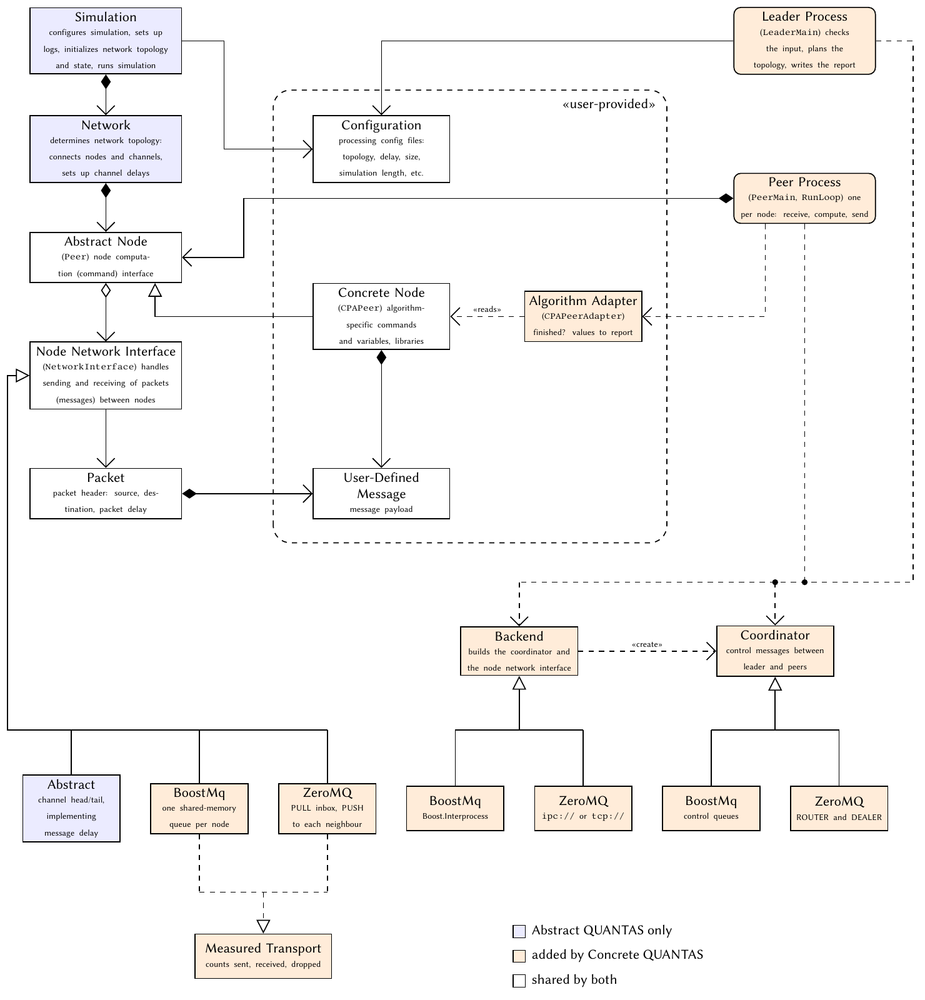

# QUANTAS
A Quantitative User-friendly Adaptive Networked Things Abstract Simulator.

QUANTAS is an abstract, round-based simulator for studying distributed algorithms without committing to a specific network stack or operating system. The platform lets you compose experiments by mixing algorithm implementations, network topologies, and stochastic message-delay/disruption models. Recent updates add first-class support for modelling Byzantine behaviour, allowing you to attach reusable fault strategies to subsets of simulated peers.

The same algorithm code can also run in **Concrete mode**, where every peer is a real operating-system process and peers exchange real messages, either on one machine or across several machines. This lets you compare a simulated run with a run on real processes, real scheduling and real elapsed time. See [Running in Concrete Mode](#running-in-concrete-mode).


## Build Dependencies

By default, QUANTAS targets Linux and uses `g++ 9` or newer. Install it with:

```sh
sudo add-apt-repository ppa:ubuntu-toolchain-r/test
sudo apt update
sudo apt install g++-9
```

Concrete mode also needs Boost (headers and Boost.Serialization), ZeroMQ (libzmq) and its C++ header `zmq.hpp` (cppzmq):

```sh
sudo apt install libboost-serialization-dev libzmq3-dev cppzmq-dev     # Debian / Ubuntu
sudo dnf install boost-devel zeromq-devel cppzmq-devel                 # Fedora
make check_mq_deps                                                     # checks that they compile and link
```

If you prefer Clang, build with `make clang`. The Makefile uses Python 3 to read the input file.

External libraries bundled in the repository:

- [nlohmann/json](https://github.com/nlohmann/json) for JSON parsing.
- [BS-Thread-Pool](https://github.com/bshoshany/thread-pool) for parallel round execution.

## Building and Running the Abstract Simulator

Clone the repository, pick the algorithm/input configuration you want to exercise, then build and run via the provided `Makefile`.

1. Select an input JSON file by setting `INPUTFILE` in the root `Makefile` (or override on the command line: `make run INPUTFILE=quantas/ExamplePeer/ExampleInput.json`). The chosen file also determines which algorithm sources are compiled.
2. Build:
    ```sh
    make release
    ```
3. Execute the configured experiment suite:
    ```sh
    make run
    ```
    Use `make debug` for an unoptimised build with debug symbols, or `make run_simple_memory` / `make run_debug` for valgrind and gdb helpers.

Run `make` with no target to list all targets, and `make test` to run the unit and integration tests (in `quantas/Tests/`).

## Running in Concrete Mode

In Concrete mode, a launcher starts one **leader** process and one **peer** process per peer, all from the same input file. The leader validates the input, plans the topology, coordinates each test and writes the report. Each peer receives its pending messages, runs `performComputation()`, reports delivery the first time it happens, and repeats every 10 ms until the leader stops it or its time window (`windowMs`) ends. Delays come from the real system, so `distribution` is ignored, and a test is bounded by `windowMs` instead of `rounds`.

Two communication backends are available, selected by the experiment's `backend` field:

- **ZeroMQ** (`zeroMq`, the default): sockets over `ipc://` on one machine, or over `tcp://` across several machines.
- **BoostMq** (`boostMq`): Boost.Interprocess message queues in shared memory (`/dev/shm`), on one machine.

### Architecture

The figure extends the architecture of the original QUANTAS paper (class names in parentheses). Blue components exist only in the Abstract simulator, orange ones are added by Concrete mode, and white ones are shared.



The Concrete runtime (`quantas/Common/Concrete/Runtime/`) does not know how messages travel. It uses three interfaces (`Runtime/Interfaces/`):

- `Backend` reads the backend's settings, checks before a run that the experiment can execute, and creates the two objects below. `Backends/BackendFactory.cpp` selects it from the `backend` field.
- `Coordinator` is the control plane: the messages between the leader and the peers.
- `NetworkInterface` is the data plane: it carries the algorithm's messages. Each backend's transport also implements `MeasuredTransport`, which counts the messages sent, received and dropped.

The leader (`Runtime/Engine/LeaderMain.cpp`), the peer (`Runtime/Engine/PeerMain.cpp`, loop in `RunLoop.cpp`) and the algorithms depend only on these interfaces. To add a backend, implement them in `Backends/<Name>/` and add one line to the factory.

Every test follows the same protocol on both backends:

1. Each peer opens its channels and sends READY to the leader.
2. The leader waits for every peer, then sends each one its identifier and its neighbours.
3. Each peer creates its transport and algorithm object, and the leader sends START.
4. Peers run the algorithm. A correct peer sends DELIVERED the first time it delivers.
5. Once every correct peer has delivered, the leader sends STOP. Without STOP, a peer stops when its `windowMs` ends.
6. Each peer writes its metrics file and sends DONE, or FAILED after an error.
7. The leader reads the metrics files and adds the test to its report.

A timeout, a FAILED message or an invalid metrics file marks the test as failed, so a run never hangs. A data send that times out on a full queue also fails the test: messages are never dropped silently.

### Algorithm adapter

Algorithms run in Concrete mode unchanged. The runtime needs only two answers that a generic `Peer` cannot give: whether a peer has finished (so the leader can stop a test once every correct peer has), and which values to report. An optional *algorithm adapter* provides them by reading the algorithm's public state, in its own file `quantas/Common/Concrete/Adapters/<Name>Adapter.cpp`. The build links it when the input lists `<Name>.cpp`. The adapter for MT-CPA:

```cpp
static const bool registered = registerAlgorithmAdapter<CPAPeer>(
    [](const CPAPeer& peer) { return peer.delivered; },          // finished?
    [](const CPAPeer& peer) {                                     // values for the report
        return nlohmann::json{{"peer_id", peer.publicId()},
                              {"is_byzantine", peer.isByzantine},
                              {"delivered", peer.delivered},
                              {"delivered_value", peer.mDelivered},
                              {"delivery_round", peer.deliveryRound},
                              {"messages_sent", peer.msgsSent}};
    });
```

Without an adapter, an algorithm still runs, but each test lasts the whole `windowMs` and the report has no algorithm values. A peer process cannot see the other peers' state, so Abstract code that scans all peers has no effect in Concrete mode; the leader's STOP replaces it.

### Single-machine concrete run

```sh
make mq INPUTFILE=quantas/CPAPeer/ConcreteExampleInput.json
```

This builds the leader and peer programs (`quantas_mq_leader.exe`, `quantas_mq_peer.exe`), removes leftover queues, runs every experiment of the input and cleans up. The example runs MT-CPA on 6 peers, first on BoostMq, then on ZeroMQ. Use `make mq_debug` for debug binaries, or `make mq_release` to build without running.

### Multi-host concrete run

ZeroMQ runs over `tcp://` when the input names the machines:

```json
"backend": "zeroMq",
"zeroMq": {
  "leaderHost": "node1",
  "peerHosts": ["node2", "node3"],
  "basePort": 15555
}
```

Peer i runs on `peerHosts[i % size]` and listens on port `basePort + 1 + i`, so every peer can compute its neighbours' addresses. The algorithm and the rest of the input stay the same.

1. Put the repository in a folder that all machines share (the leader reads the metrics files the peers write there).
2. Build once: `make mq_release INPUTFILE=input.json`.
3. For experiment `E` of the input, start the leader, then each peer on its machine:
    ```sh
    ./quantas_mq_leader.exe --experiment E input.json          # on leaderHost
    ./quantas_mq_peer.exe --experiment E input.json <id>       # on the machine of peer <id>, once per peer
    ```

The ports must be reachable between the machines. `tcp://` has no authentication: use it only on a trusted network, such as a cluster's internal network.

### Backend settings

A block named after the backend holds its settings. All are optional; the defaults suit small experiments.

BoostMq (`"boostMq": {...}`):

- `dataQueueCapacity` (default 1000): messages a peer's inbox can hold.
- `maxMessageSizeBytes` (default 4096): largest message allowed.
- `dataSendTimeoutMs` (default 10): how long a send waits on a full inbox before the test fails.
- `controlSendTimeoutMs` (default 5000): how long the leader waits to send a control message.
- `readyTimeoutMs` (default 30000): how long the leader waits for every peer's READY.

Boost reserves each queue in full, so the data queues need about `peers × dataQueueCapacity × maxMessageSizeBytes` of `/dev/shm` (100 peers × 20,000 × 4 KB ≈ 7.8 GB). Check `df -h /dev/shm` before raising these values.

ZeroMQ (`"zeroMq": {...}`):

- `dataQueueCapacity` (default 1000): high-water mark of each data socket. ZeroMQ applies it per connection, at both ends, so a send to a stalled peer times out after about twice the capacity.
- `dataSendTimeoutMs` (default 10) and `readyTimeoutMs` (default 30000): as for BoostMq.
- `leaderHost`, `peerHosts`, `basePort` (default 5555): see [Multi-host concrete run](#multi-host-concrete-run). Without hosts, ZeroMQ uses `ipc://` files in `/tmp`.

Neither backend simulates delays: the timeouts only decide when to give up. A capacity that is too low shows up as a failed test, not as lower liveness or safety; raise `dataQueueCapacity` for algorithms that send many messages.

### Troubleshooting

```sh
make mq_status    # running leader/peer processes and queues
make mq_cleanup   # remove leftover queues (refuses while processes run)
```

Do not run `rm /dev/shm/*`: it can delete other programs' files. A long `performComputation()` is not interrupted, because the deadline is only checked between iterations.

## Simulation Input Reference

A simulation is described by a JSON document with two top-level keys:

```json
{
    "algorithms": ["ExamplePeer/ExamplePeer.cpp"],
    "experiments": [{/* experiment description */}]
}
```

- `algorithms` lists the C++ translation units (relative to `quantas/`) that should be compiled into the executable. Each file registers at least one peer type with `PeerRegistry`.
- `experiments` is an array of experiment objects. QUANTAS runs them sequentially.

### Common experiment fields

Every experiment object can contain:

- `logFile`: Output destination for metrics. Use a filename to create/append to that file, or `"cout"` to emit JSON metrics on stdout. In Concrete mode it names the results folder.
- `threadCount`: Desired worker threads for message delivery and computation. The runtime caps this at the number of peers.
- `tests`: Repeat count for the experiment (default 1). Each repetition re-initialises the topology and random seeds.
- `rounds`: Number of synchronous rounds to execute per test. Concrete mode still requires it but stops on `windowMs`.
- `distribution`: Network/channel configuration (see below). Ignored in Concrete mode.
- `topology`: Initial network description (see below).
- `parameters`: Arbitrary JSON payload forwarded to the algorithm during `Peer::initParameters`. Keys are algorithm-specific (examples listed later).

Concrete mode adds:

- `backend`: `"zeroMq"` (default) or `"boostMq"`.
- `windowMs`: Longest time a peer runs in one test, in ms (default 2000).
- `doneTimeoutMs`: How long the leader waits for the peers to finish a test, in ms (default 30000).
- `boostMq` / `zeroMq`: Settings of that backend (see [Backend settings](#backend-settings)).

`windowMs` and `doneTimeoutMs` also accept `"infinite"`, which removes the limit.

### `distribution`

`distribution` controls how channels inject latency and faults. Supported keys (all optional):

- `type`: One of `UNIFORM`, `POISSON`, or `ONE`. `UNIFORM` (default) selects a uniform integer delay in [`minDelay`, `maxDelay`]; `POISSON` samples a Poisson variate with mean `avgDelay`, clamped by the min/max bounds; `ONE` always delivers in the next round.
- `minDelay`, `maxDelay`: Inclusive bounds for delivery delay (defaults to 1).
- `avgDelay`: Mean used by the Poisson model.
- `dropProbability`: Probability that an outbound packet is discarded instead of enqueued.
- `duplicateProbability`: Chance to duplicate an outbound packet (duplicates reuse the sampled delay).
- `reorderProbability`: Chance to shuffle the in-flight queue before delivery.
- `maxMsgsRec`: Per-round cap on the number of packets a channel will deliver.
- `size`: Maximum queue length per channel.

These properties are applied to every channel created when the topology is instantiated.

### `topology`

`topology` declares how peers are created and connected at the beginning of the experiment.

Required keys:

- `initialPeers`: Number of peers to instantiate.
- `initialPeerType`: Symbol registered via `PeerRegistry::registerPeerType` that identifies which `Peer` subclass to construct (for example `PBFTPeer`, `RaftPeer`, `BitcoinPeer`).
- `type`: One of:
    - `complete`: Fully connected graph.
    - `star`: Peer 0 connected to everyone.
    - `grid`: 2D grid; requires `height` and `width` (height × width must equal `initialPeers`).
    - `torus`: Grid with wrap-around edges.
    - `chain`: Linear chain.
    - `ring`: Bidirectional ring.
    - `unidirectionalRing`: Directed ring.
    - `userList`: Custom adjacency; requires a `list` object mapping peer indices (as strings) to arrays of neighbour indices.

Optional keys:

- `height`, `width`: Dimensions for grid/torus generation.
- `identifiers`: Use `"random"` to shuffle public identifier assignment before wiring channels, providing a quick way to simulate random IDs.

Algorithms may mutate the topology after initialisation, but these settings define the starting graph.

### `parameters`

`parameters` is forwarded verbatim to `Peer::initParameters` on the first peer. Use it to activate behaviour specific to each algorithm. Some existing patterns:

- `PBFTPeer` expects `byzantine_count` to decide how many replicas should run with equivocation faults.
- `RaftPeer` consumes crash parameters such as `crash_count`, `crash_recovery_round`, and message submission rates.
- Proof-of-Work peers (Bitcoin/Ethereum) look for mining controls like `miner_count`, `parasiteLead`, and difficulty knobs.
- `CPAPeer` (MT-CPA) reads `sender`, `ts`, `tl` and `byzantines` (the list of Byzantine peer IDs).

Feel free to embed nested objects or arrays if your algorithm benefits from richer configuration.

### Putting it together

```json
{
    "logFile": "PBFTByzantine_04.txt",
    "threadCount": 48,
    "distribution": {
        "type": "UNIFORM",
        "maxDelay": 1,
        "maxMsgsRec": 10
    },
    "topology": {
        "type": "complete",
        "initialPeers": 100,
        "initialPeerType": "PBFTPeer"
    },
    "parameters": {
        "byzantine_count": 4
    },
    "tests": 1,
    "rounds": 1000
}
```

A Concrete experiment (from `quantas/CPAPeer/ConcreteExampleInput.json`, with ZeroMQ settings added):

```json
{
    "backend": "zeroMq",
    "windowMs": 2000,
    "zeroMq": {"dataQueueCapacity": 20000},
    "logFile": "cpa_zeromq.json",
    "tests": 2,
    "rounds": 1000,
    "threadCount": 1,
    "distribution": {"type": "UNIFORM", "maxDelay": 1},
    "topology": {"type": "complete", "initialPeers": 6, "initialPeerType": "CPAPeer"},
    "parameters": {"sender": 0, "ts": 1, "tl": 1, "byzantines": [3]}
}
```

## Modelling Byzantine Behaviour

All consensus-oriented peers derive from `ByzantinePeer`, which wraps the base `Peer` with a `FaultManager`. Faults are modular strategies that can intercept and alter peer actions by overriding any combination of:

- `onUnicastTo`: customise direct sends to a specific neighbour.
- `onSend`: intercept broadcast/multicast/random-multicast traffic.
- `onReceive`: rewrite or drop inbound messages.
- `onPerformComputation`: skip or replace the algorithm’s normal round logic.

Bundled fault implementations live under `quantas/Common/`:

- `EquivocateFault` (`Common/equivocateFault.hpp`): Splits a multicast across two quorum sets and injects conflicting payloads, enabling PBFT-style equivocation experiments.
- `ParasiteFault` (`Common/ParasiteFault.hpp`): Models selfish mining by intercepting Proof-of-Work block broadcasts, coordinating a private chain among collaborators, and releasing it once it outruns the public chain.

Attach faults from your algorithm’s `initParameters`. For instance, `PBFTPeer` reads `parameters.byzantine_count` and adds an `EquivocateFault` to the first _n_ replicas. You can define bespoke attacks by subclassing `Fault`, overriding the relevant hook(s), and adding the instance through `ByzantinePeer::addFault`.

## Logging and Metrics

`LogWriter` aggregates per-test metrics into structured JSON records. Algorithms push values during execution (for example PBFT tracks throughput, latency, and faulty confirmations). Each experiment writes its metrics at the end of the run, either to stdout (`logFile = "cout"`) or to the named log file.

In Concrete mode, each experiment writes to `Results/<NN>EXP_<name>/` (`<NN>` is its position in the input, `<name>` is `logFile` without its extension):

- `leader_report.json`: the settings, `success`, and one entry per test in `tests[]` with `success`, `timedOut`, `stop_reason`, `durationSeconds`; `algoReliability` (for MT-CPA: `avg_termination` = liveness, `avg_safety`, `avg_delivery_time_ms`, `total_msg_sent`, `avg_msg_sent`); `transportReliability` (messages sent, received, dropped, pending at shutdown); and `brb_completion_time_ms`.
- `peer_<id>_TEST<n>.<ext>`: each peer's metrics, transport counters, run time and peak memory.

Concrete delivery times are in milliseconds and depend on scheduling and load, so compare them with Abstract rounds only by trend.

## Platform Notes

### macOS

```sh
make clang
```

### Visual Studio

To use the simulator inside Visual Studio:

1. Create an empty solution.
2. Add all `.cpp` and `.hpp` files from `quantas/` and `quantas/Common/` as existing items.
3. Set the command arguments for debugging to the desired input file path (for example `C:\Users\User\Documents\QUANTAS\quantas\ExamplePeer\ExampleInput.json`).
4. Define the algorithm macro under **Project → Properties → C/C++ → Preprocessor** (e.g., `EXAMPLE_PEER`).
5. Ensure the C++ language standard is set to C++17 or newer.

Concrete mode runs on Linux only.

## Further Info

QUANTAS is further described here:
[QUANTAS: Quantitative User-friendly Adaptable Networked Things Abstract Simulator](https://arxiv.org/abs/2205.04930)

```
@article{oglio2022quantitative,
  title={QUANTAS: Quantitative User-friendly Adaptable Networked Things Abstract Simulator},
  author={Oglio, Joseph and Hood, Kendric and Nesterenko, Mikhail and Tixeuil, Sebastien},
  journal={arXiv preprint arXiv:2205.04930},
  year={2022}
}
```
