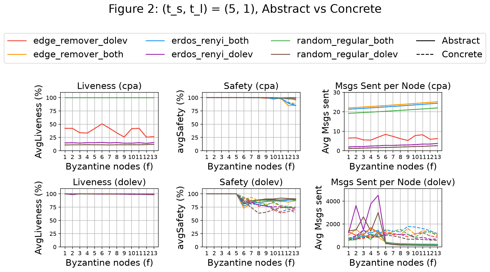
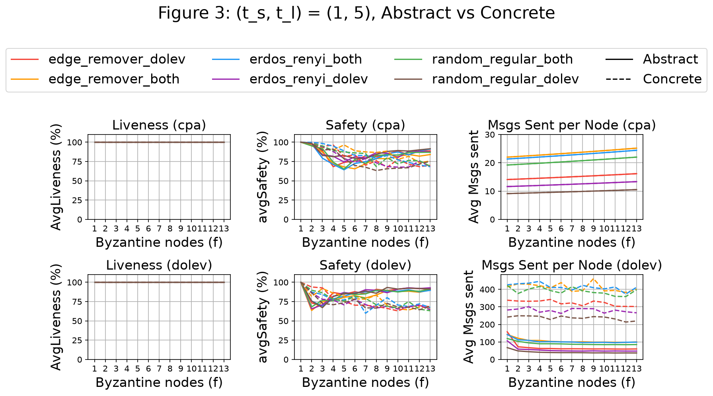
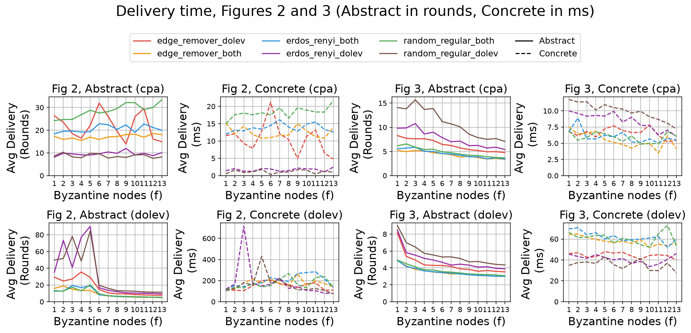

# Figures 2 and 3 on Abstract and Concrete QUANTAS

**Goal:** rerun the experiments behind the paper's Figures 2 and 3 (*Multi-Threshold Reliable Communication on Graph Networks*, §5) on **Concrete QUANTAS**, where every node is a real OS process, and compare them with the paper's **Abstract** results.

## Setup

- **Networks:** 100 nodes, sender = node 0, k = 7. Three families (edge remover, Erdős–Rényi, random regular), each with 10 `both` networks (valid for CPA and Dolev) and 10 `dolev` networks (valid for Dolev only).
- **Thresholds:** Figure 2 = (t_s, t_l) = (5, 1); Figure 3 = (1, 5).
- **Byzantine nodes:** t = 1–13
- **Abstract:** Lorenzo's `results_100` (the paper's data).
- **Concrete:** 3,120 experiments (2 algorithms × 3 families × 20 networks × 13 values of t × 2 threshold pairs). The algorithm code is identical to Abstract. Settings: queue 20,000 messages, window 2 s, done timeout 120 s.
- **Plots:** each line is the mean over the 10 networks of one family and network type. **Solid = Abstract, dashed = Concrete.** Failed Concrete tests are excluded (§ Limitations).
- **Metrics:**
  - **Liveness:** % of honest nodes that accepted a value. *Did the honest nodes get the message?*
  - **Safety:** % of the accepting honest nodes that accepted the most common value (agreement, as computed in both implementations). *Did they agree on the same message?*
  - **Messages per node** (`avgMessagesSent`): all messages sent in the test (including the Byzantine nodes'), divided by the number of honest nodes. *How much did it cost?*
  - **Delivery round** (`avgDeliveryRound`, Abstract only): the average round in which the accepting nodes accept. *How fast, in simulated rounds?*
  - **Delivery time** (`avg_delivery_time_ms`, Concrete only): the average time, in milliseconds, from a node starting until it accepts. *How fast, in real time?* Rounds and milliseconds are different units, so only the trends are compared.

## Figure 2: (t_s, t_l) = (5, 1)

## Figure 3: (t_s, t_l) = (1, 5)

## Delivery time

Delivery time is in rounds in Abstract and in milliseconds in Concrete, so the two are shown side by side, not overlaid.

## Figure 2 vs Figure 3

The two figures use **the same networks, liars and code**. The only difference is how each honest node is configured, i.e. the threshold pair.

### Figure 2, (t_s, t_l) = (5, 1): cautious

A node accepts only after **6** independent confirmations. It is hard to fool (up to 5 Byzantine nodes), but delivery is only guaranteed with at most 1 Byzantine node.

- **Liveness:** the same on both backends, for CPA and Dolev.
- **Safety of CPA:** stays at 100% up to 6 Byzantine nodes in every topology family. It starts to drop from t = 7 on `erdos_renyi_both` and `edge_remover_both`, and later (t = 9–11) on the others. It stays above 97% until t = 12–13, where the `both` networks fall to about 85–89%. Abstract and Concrete are almost identical.
- **Safety of Dolev:** 100% up to t = 5 on both backends; it drops from t = 6 (one more than t_s) in every topology family. Beyond t_s, Concrete is lower: about 73–82% on average vs 84–90% in Abstract (lowest values ~64% vs ~73–86%).
- **Messages per node:** CPA's `avg_msg_sent` is the same on both backends. Dolev differs:
  - **Abstract** sends a lot for t ≤ 5 (about 850–2,900 per node, peaking at 4,519 on `erdos_renyi_dolev`), then drops sharply to about 170–280 from t = 6.
  - **Concrete** stays roughly flat at about 750–1,500 per node for every t.
  - So Abstract is higher for t ≤ 5, and Concrete is higher for t > 5.

### Figure 3, (t_s, t_l) = (1, 5): trusting

A node accepts after **2** confirmations. Delivery is guaranteed with up to 5 Byzantine nodes, but 2 Byzantine nodes can already fool it.

- **Liveness (CPA and Dolev):** 100% everywhere, on both backends. With t_s = 1 a node needs only 2 neighbours, so even the `dolev` networks work for CPA.
- **Safety of CPA:** drops from t = 2 in every topology family, on both backends, because 2 Byzantine nodes can already fake the 2 confirmations needed. Beyond t_s it averages about 75–86%. The backends are close but not identical; per line they differ by a few points in either direction.
- **Safety of Dolev:** also drops from t = 2. Concrete is lower: about 71–76% on average vs 82–86% in Abstract.
- **Messages per node:** CPA is identical on both backends (about 16–18). Dolev sends about **3–5× more** in Concrete than in Abstract (about 230–430 vs 40–120), roughly flat across t, and still far fewer than in Figure 2.
- **Delivery time:** faster than in Figure 2 on both backends, because fewer confirmations are needed.

In short: **Figure 2 trades speed and cost for safety; Figure 3 trades safety for speed, cost and guaranteed delivery.** The same trade-off appears in Concrete.

## Results

Values are averaged over all lines; "t > t_s" is the region beyond the safety threshold.

| Metric | Figure 2 (5, 1) | Figure 3 (1, 5) | Abstract vs Concrete |
|---|---|---|---|
| **CPA liveness** | `both` 100%, `dolev` 11–51% | 100% | **Identical** (0.00 points) |
| **CPA messages/node** | 12–14 | 16–18 | **Identical** |
| **CPA safety, t > t_s** | Abs 98.3%, Conc 98.6% | Abs 82.8%, Conc 80.7% | Very close |
| **Dolev liveness** | 99.6–100% | 100% | Match |
| **Dolev safety, t > t_s** | Abs 86.7%, Conc **77.4%** | Abs 84.7%, Conc **73.9%** | **Concrete ~10 points lower** |
| **Dolev messages/node** | t ≤ 5: Abs 1,534, Conc 925; t > 5: Abs 234, Conc 1,113 | Abs 74–123, Conc 317–354 | Differ; timing-dependent |
| **CPA delivery** | Abs 16–20 rounds, Conc 9–11 ms | Abs 5–9 rounds, Conc 6–8 ms | Same trend |
| **Dolev delivery** | Abs 7–43 rounds, Conc 113–242 ms | Abs 4–7 rounds, Conc 45–54 ms | Same trend |

### Main observations

1. **CPA behaves identically on both backends.** Its rule only counts distinct neighbours, and each node broadcasts once, so timing doesn't matter (RQ1, RQ5).
2. **Liveness is preserved in both backends,** except CPA on `dolev` networks with t_s = 5, which the paper explains by network structure (RQ1, p. 13; RQ3, p. 15).
3. **Safety holds up to t_s in both backends** (RQ2). Beyond t_s, Concrete Dolev is about 10 points lower than Abstract. The cause hasn't been investigated yet.
4. **Higher t_s means slower delivery in both backends** (RQ4, p. 15), confirmed on real processes.
5. **Dolev's message count depends on timing.** It is always much higher than CPA's, and Figure 2 always costs more than Figure 3 (RQ5, p. 16). Concrete peers relay every new path they've read before checking delivery, and messages arrive in batches (100 processes on 8 cores). A test at k = 3 confirmed this mechanism: checking after every message removes the excess.

## Limitations

1. **Dolev stalls:** 11 of 1,560 Concrete Dolev tests (0.7%) hit the 120 s timeout, all at (5, 1) with t = 3–5. Profiling showed `k_disjoint` (*do I have 6 separate paths for this value?*) needing up to 231 s to prove that the forged value has no 6 disjoint paths, which is an exhaustive search. Abstract counts rounds, not time, so it never sees this cost.
   - **What happened:** 11 of the 1,560 Concrete Dolev runs (less than 1 in 100) did not finish within the 120 s limit, so they were recorded as failures and left out of the graphs.
   - **Why:** every node runs `k_disjoint` for each value it has received.
     - For the **real value**, the answer is **yes**, and the search stops as soon as it finds 6 separate paths (about 0.001 ms).
     - For the **fake value**, with only 3–5 Byzantine nodes, the answer is **no**: every fake path starts at a Byzantine node, so there cannot be 6 separate ones. To be sure of "no", the search has to try **every combination** of paths, which with hundreds of paths can take minutes (the worst case measured: **231 s**).
     - *Like looking for 6 matching socks in a huge pile: if they are there, you stop when you find them; if they are not, you have to check the whole pile before you can say so.*
   - **Why only these runs:**
     - **Only (5, 1):** it needs 6 paths. Figure 3, (1, 5), needs only 2, which is a tiny search.
     - **Only t = 3–5:** enough Byzantine nodes to create many fake paths, but fewer than 6, so the fake can never succeed. That is the worst case: lots of searching, and the answer is always "no".
   - **Why Abstract never shows this:** Abstract counts **rounds**, not seconds. A 231 s search still counts as one round, so the cost is invisible. In Concrete, the real process is actually busy for minutes.
   - **In short:** this is not a bug in Concrete; it exposes a real cost of Dolev's delivery check that the round-based simulator hides.

2. **Dolev message counts are timing-dependent** (observation 5), so compare them as ranges.
3. **Delivery units differ** (rounds vs ms); only the trends are comparable.
4. **Hardware:** 100 processes on an 8-core machine.

## Questions for Lorenzo

1. Lorenzo's Dolev **stops relaying after delivering**, but the paper's Algorithm 2 doesn't. Was this intended? It means the paper's "lower bound" note on message counts (p. 11) doesn't apply to these numbers.
2. **Legend colours:** in the paper's Figures 2 and 3, the Dolev row's colours don't match the legend. `plots_2.py` colours each row in its data order, but takes the legend from the CPA row. These figures use fixed colours.

---
*Data:* `experiments/{CPA,Dolev}/csv/concrete_*_k7.csv` · *Figures:* `experiments/figures/figures_2_3.py` · *Details:* `experiments/STATUS.md`, `experiments/concrete-settings.md`
