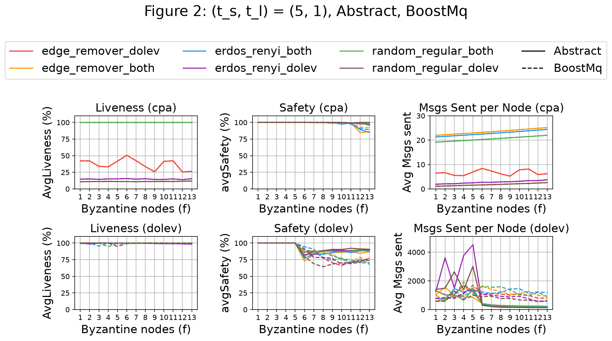
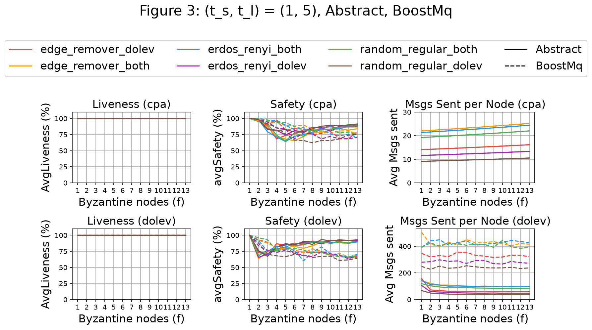

# Evaluation

## Setup
<!-- MT-CPA / MT-Dolev experiments [@opodis-mtrc]: n = 100, three families, k = 3, 5, 7,
t = 1..2k-1, t_s + t_l = k - 1. Abstract: 1000 rounds. Concrete: 2 s window.
Machine: Intel Core Ultra 5 228V, 8 cores, 30 GB RAM, Fedora, GCC 16.2.1. -->
TODO

## Correctness
<!-- Within bounds (f <= min(t_s, t_l); CPA only on "both" networks), no time limits:
every run must reach 100% liveness and safety. -->
TODO

## Abstract vs Concrete on one machine
<!-- Figures 2 and 3 of the MT paper on Abstract and BoostMq; run times. -->
TODO

## ZeroMQ on a cluster
<!-- Bridge: ZeroMQ matches BoostMq on one machine. Then LIP6 cluster: 1 machine x 20 peers,
2 machines x 10 peers over tcp://. -->
TODO
